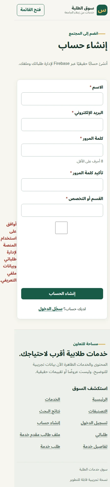
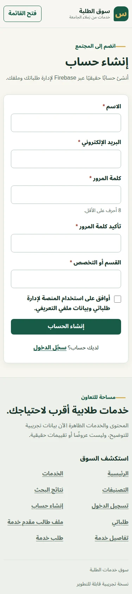
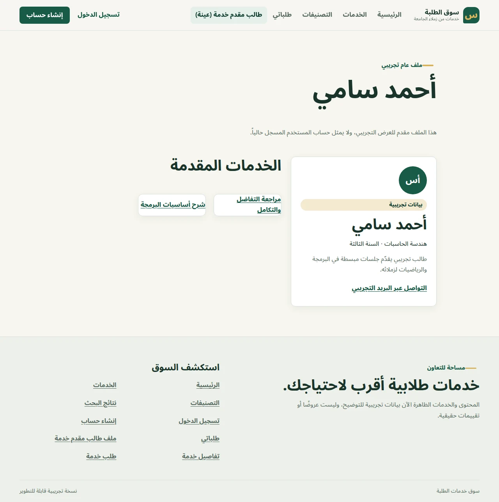
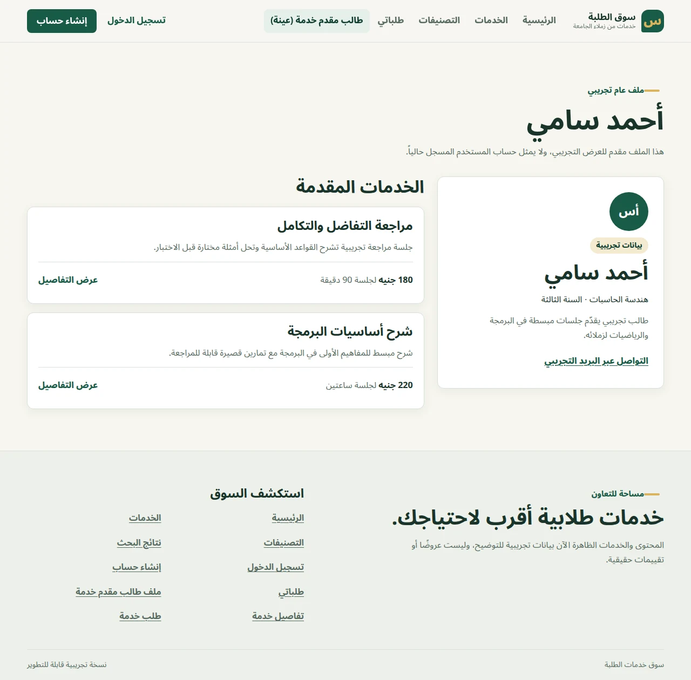
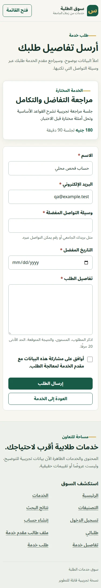
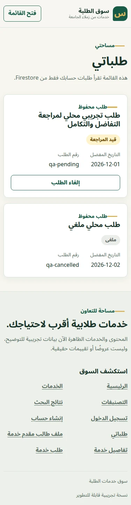

# مراجعة واجهة سوق خدمات الطلبة

**التاريخ:** 18 نوفمبر 2026. **النطاق:** الصفحات العشر، العربية RTL، على عروض 375 و768 و1280 و1920 بكسل. هذه مراجعة فعلية للواجهة والقياسات والمصدر، وليست مجرد مراجعة للكود أو وعدًا بأن كل مشكلة محتملة اختفت.

حوفظ على اللون الأخضر والخلفية العاجية والصور الأصلية ومسارات المشروع، وعلى مستوى كود قابل لشرح طالب مبتدئ. لم تُضف مكتبة واجهة جديدة، ولم تتغير خدمات Firebase أو قواعد ملكية البيانات.

## تغطية الصفحات

| الصفحة | ما تمت مراجعته وما أُصلح |
|---|---|
| الرئيسية `/` | الهيرو والبحث والتصنيفات والخدمات المميزة. توحيد ارتفاع البحث والتصنيف والزر إلى 52px، توازن الخدمات الأربع في صفين، وإدخال تعليق صورة الهيرو داخل حدود عرض التابلت. |
| الخدمات `/services` | البحث والفلاتر وقائمة الخدمات وروابط التفاصيل. حذف السعر المكرر خارج البطاقة وإرجاع زر تطبيق الفلاتر لعرض طبيعي على الكمبيوتر، مع بقائه واسعًا على الموبايل. |
| التصنيفات `/categories` | البطاقات الثلاث وروابطها وتخطيط التابلت. إزالة تضارب قواعد الشبكة وتفادي صف البطاقة الوحيدة عند 768px. |
| البحث `/search` | النتائج بالكلمة والتصنيف، وحالة عدم وجود نتائج. لم تثبت مشكلة مستقلة تتطلب إعادة تصميم؛ استفاد من إصلاح الحقول والفوكس المشترك. |
| تفاصيل الخدمة `/services/tutoring-calculus` | الصورة والوصف والسعر ومقدم الخدمة وروابط التواصل والطلب. التخطيط سليم في المقاسات المفحوصة؛ عولج تباين الفوكس المشترك. |
| طلب الخدمة `/request/tutoring-calculus` | حالة الزائر الذي يحتاج دخولًا، والنموذج المسجل محليًا. إصلاح نص الموافقة المنهار خارج البطاقة وحجم checkbox، وحشو ملخص الخدمة، وفوكس أول حقل خاطئ. |
| الدخول `/login` | الحقول والتسميات وحالة النموذج الناقص وروابط التسجيل. إضافة landmark رئيسي وفوكس أول خطأ دون تغيير المصادقة. |
| التسجيل `/register` | حقول الحساب وصف كلمات المرور والموافقة. إصلاح overflow ونص الموافقة وحجم checkbox ومحاذاة كلمة المرور، وربط خطأ الموافقة بالحقل وإضافة main. |
| طلباتي `/my-requests` | تنبيه الزائر، ثم بطاقتا الطلب pending/cancelled والحالة الفارغة والخطأ في QA محلي. إضافة حشو البطاقات وتقليل عنوانها وفصل ألوان الحالة بعد ظهور البطاقات في الفحص المحلي. |
| ملف الطالب `/students/student-ahmed` | الملف التجريبي وخدماته، وواجهة تعديل الحساب في QA محلي. تقليل الفراغ الزائد، تصحيح الشارة والحشو، واستبدال العناوين الضيقة ببطاقات واضحة ذات وصف وسعر ورابط تفاصيل، وإضافة main وفوكس أول خطأ. |

الحساب المحلي هو `qa-owner` فقط داخل بيئة فحص منفصلة خارج مستودع التطبيق. لا يوجد مستخدم مزيف أو مسار تجاوز للمصادقة في كود الإنتاج.

## المشكلات الأساسية وإثبات التصحيح

### الموافقة في التسجيل والطلب

كانت قاعدة `.field input` تمنح خانة الموافقة عرض حقل النص كله وحدًا أدنى لارتفاعه؛ لذلك ضُغط الكلام في عمود رفيع خارج الكارت. أصبحت قواعد حقول النص تخص أبناء `.field` المباشرين، وأصبحت خانة الموافقة 20×20px داخل label قابل للنقر بارتفاع أدنى 44px، والنص بجوارها داخل مساحة مرنة.

عند عرض 375px، كانت خانة التسجيل 321×48px وارتفاع label نحو 244.69px؛ بعد التصحيح أصبحت 20×20px وارتفاع label نحو 54.38px. نموذج الطلب المحلي كان يعاني المشكلة نفسها: label نحو 271.88px، وأصبح نحو 54.38px. لا يوجد تجاوز أفقي في القياسات التالية للإصلاح.

**التسجيل قبل الإصلاح:**

**التسجيل بعد الإصلاح:**

### محاذاة كلمة المرور

عند 1280px كان ارتفاع الحقلين نحو 49.97 و65.41px وموضع بدايتهما مختلفًا بسبب تمدد صف Grid مع التلميح. أصبحت الحقول 52px، ومحاذاة الشبكة تبدأ من الأعلى، وبداية الحقلين متطابقة في القياسات. علامة المطلوب فقط هي الحمراء؛ لم يعد نص الموافقة يأخذ لون الخطأ في الحالة العادية.

### ملف الطالب

كان عمود الخدمات يحجز ثلاثة أعمدة لخدمتين، وتظهر روابط ضيقة بلا حشو مفيد. أصبح عمود الخدمات قائمة بطاقات ممتلئة فيها اسم الخدمة ووصفها وسعرها ووحدتها، وكل بطاقة رابط تفاصيل واحد بلا روابط متداخلة. شارة «بيانات تجريبية» أصبحت بحجم محتواها، ونموذج الحساب له حشو فعلي.

**الملف قبل الإصلاح:**

**الملف بعد الإصلاح:**

### الكيبورد والوصول

Escape يغلق قائمة الموبايل ويعيد الفوكس إلى زرها. رابط تخطي التنقل ينقل الفوكس إلى المحتوى. كل صفحة مستقرة من الصفحات العشر تحتوي main واحدًا؛ لم يُحوّل غلاف Layout إلى main لأن بعض الصفحات كانت تحتويه بالفعل، وهو ما كان سيخلق main متداخلًا.

حُسّن الفوكس إلى حلقة خضراء على الخلفيات الفاتحة وحلقة بيضاء داخل الهيرو الأخضر، وأُزيل إلغاء outline من البحث. النماذج تنقل الفوكس إلى أول حقل غير صالح بعد إظهار الأخطاء. أضيف زر خروج واضح للحساب المسجل يستدعي خدمة Auth القائمة، مع حالات انتظار وفشل مفهومة.

## نتائج التحقق

نجحت **42 حالة وحدة ومكون**، ومنها اختبارات جديدة للموافقة والفوكس وEscape وتسجيل الخروج وبطاقات الملف، مع بقاء اختبارات البحث وعزل الحسابات ناجحة. اختبارات قواعد Firestore العشر لا تعمل في أمر الوحدة العادي دون المحاكي وتظهر skipped فيه؛ سبق نجاحها فعليًا على المحاكي، ويشغّلها CI في خطوة منفصلة. لم تتغير القواعد في هذا التعديل.

نجح build الإنتاج. بقي تحذير حجم حزمة Firebase؛ لم يُخفَ التحذير أو تُضف تغييرات تقسيم حزم تُعقّد الكود ضمن إصلاح الواجهة.

بعد التصحيح، قياسات الصفحات العشر وحالات الحساب المحلية الثلاث في المقاسات الأربعة سجلت: **لا overflow أفقي، لا صور مكسورة، لا pageerror، وmain واحد لكل صفحة**. فحص axe الآلي لم يسجل مخالفات ضمن قواعد WCAG A/AA المختارة على عرض 1280px. هذه نتيجة الفحص المحدد، **وليست إثبات توافق كامل مع WCAG أو اختبار قارئ شاشة فعلي**.

تحقق إضافي آلي عند عرض320px نجح للصفحات العشر بلا overflow. تأكد أيضًا تساوي ارتفاع ومحاذاة كلمتي المرور، وارتفاع عناصر البحث الثلاثة52px، وظهور حلقة فوكس3px باللون المناسب داخل الهيرو والبحث. لم يتسبب اسم عرض اختباري من80 حرفًا في تجاوز التنقل على الكمبيوتر.

نجحت 11 خطوة تفاعلية في Chromium: أخطاء التسجيل والدخول والطلب والملف، نقر نص الموافقة، Escape والفوكس، رابط التخطي، البحث والتصنيف والنتائج الفارغة، وبطاقات الطلبات المحلية وإلغاؤها وحالاتها. حفظ/إلغاء QA يعود من خدمات محاكاة محلية فقط، وقد حُظر الاتصال الخارجي أثناء تلك الخطوات.

**واجهة الطلب في QA محلي فقط:**

**بطاقات طلباتي في QA محلي فقط:**

## ما لم يكتمل

لا توجد قاعدة Cloud Firestore بعد. إنشاء القاعدة ونشر القواعد واختبار إنشاء حساب وملف وطلب فعلي ما زال ينتظر موافقة صاحب المشروع على المنطقة الدائمة. الصور المحلية لا تثبت هذه الخطوات، ونسخة الإنتاج لا تتضمن بدائل بيانات QA. قبول المدرس للنشر على Vercel بدل سيرفر الجامعة غير مثبت.

الموقع يستخدم [رابط الإنتاج الدائم](https://student-services-marketplace.vercel.app). تُراجع حالة نشر التعديل من Checks الخاصة بآخر commit في [المستودع](https://github.com/alf-2006/student-services-marketplace)، ولا يُستنتج نجاح تحديث جديد من نجاح نسخة أقدم.
